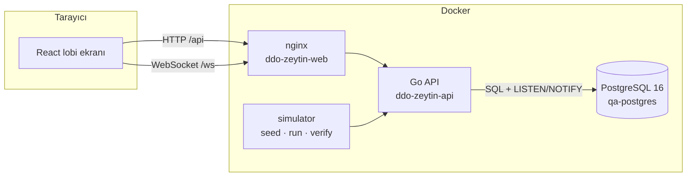

# DDO — Şube Sıra ve Randevu Sistemi

Çok şubeli bir kurum için sıra bileti, gişe çağırma, randevu ve lobi ekranı sistemi.

- **Backend:** Go 1.22, Chi, PostgreSQL 16
- **Frontend:** React + Vite ile canlı sıra ekranı
- **Simülatör:** 50 şubeye trafik üreten ve tüm gereksinimleri doğrulayan ayrı bir Go CLI aracı

Tasarım kararlarının gerekçeleri [DECISIONS.md](DECISIONS.md) dosyasında, test stratejisi ve kanıtlar [TESTING.md](TESTING.md) dosyasında.

## Hızlı başlangıç

Gereken: Docker ve Compose v2.17 veya üstü.

```bash
cp .env.example .env    # JWT_SECRET (≥32 bayt) ve ADMIN_PASSWORD değerlerini doldurun
make verify             # imajları derler, stack'i sağlıklı hâle getirir, F-1…T-4'ü test eder
```

`make verify` çıktısı:

```
ID   Gereksinim                                               Sonuç  Süre   Ayrıntı
F-1  Kimlik doğrulama (Argon2id + JWT, refresh rotasyonu)     PASS   58ms   12 assertions
…
T-4  Race condition yok (SKIP LOCKED, eşzamanlı idempotency)  PASS   382ms  54 assertions

10/10 PASS
```

| Adres | Ne |
|---|---|
| http://localhost:3000 | Lobi ekranı (giriş: `seed.display@ddo-case.invalid`, önce `make seed` çalıştırılmalı) |
| http://localhost:8080 | API (`ddo-zeytin-api` container'ı) |
| localhost:5432 | PostgreSQL (`qa-postgres`) |

`make` yoksa (örneğin Windows) aynı işi şu komutlar yapar:

```bash
docker compose up -d --build --wait
docker compose --profile tools run --rm --build simulator verify
```

### Make hedefleri

| Hedef | Ne yapar |
|---|---|
| `make up` / `make down` / `make clean` | Stack'i başlatır (sağlıklı olana kadar bekler) / durdurur / volume ile birlikte siler |
| `make verify` | F-1…F-6 ve T-1…T-4 gereksinimlerini canlı API'ye karşı test eder, PASS/FAIL tablosu basar |
| `make verify-local API_URL=…` | Aynı kontrolleri yerel Go ile çalışan bir API'ye karşı yapar |
| `make seed` | 50 şube (her birinde 3 hizmet ve 4 gişe), 200 müşteri ve 1 ekran hesabı oluşturur |
| `make simulate DURATION=2m` | 50 şubeye bilet, randevu ve gişe çağırma trafiği gönderir |
| `make test-unit` / `make test-integration` | Birim testleri / Testcontainers entegrasyon testleri |

## Mimari



**Başlatma sırası sağlık kontrollerine bağlı.** Bir servis, bağımlı olduğu servis sağlıklı olana kadar başlamaz (`depends_on: condition: service_healthy`):

1. `postgres` (`pg_isready` ile kontrol edilir)
2. `api` (`/app/api healthcheck` ile `/health` kontrol edilir)
3. `frontend` ve `simulator`

API imajı distroless olduğu için içinde shell veya curl yok; healthcheck'i binary'nin kendisi yapıyor. Üç Go/Node imajı da multi-stage build ile üretiliyor.

### Proje yapısı

```
backend/
  cmd/api/              giriş noktası (+ `api healthcheck` alt komutu)
  internal/server/      router, middleware, arka plan işçileri (main ve e2e testleri bunu paylaşır)
  internal/auth/        Argon2id, JWT, refresh oturumları, RBAC
  internal/queue/       şube, bilet, sıra motoru, randevu, olay günlüğü, bekleme istatistiği
  internal/realtime/    WebSocket sunucusu + PostgreSQL'i izleyen hub
  internal/idempotency/ Idempotency-Key saklama ve tekrar oynatma
  internal/audit/       append-only denetim kaydı
  internal/testutil/    Testcontainers / TEST_DATABASE_URL yardımcısı
  migrations/           goose SQL migration'ları (binary'ye gömülü)
frontend/               React ekranı, WebSocket hook'u, saf board reducer'ı, nginx.conf
simulator/              seed / run / verify komutları
```

## Veritabanı

Tüm tablolar `qa-` önekiyle başlıyor; kullanıcı tablosunun adı tam olarak `"qa-ev-users"`. İsimlerde tire olduğu için SQL'de her zaman çift tırnak gerekiyor: `SELECT * FROM "qa-ev-users"`. Bu kurala uyulduğunu bir entegrasyon testi denetliyor.

| Tablo | Amaç |
|---|---|
| `qa-ev-users` | Kullanıcılar (Argon2id hash, rol, soft delete) |
| `qa-user_sessions` | Refresh token oturumları (yalnızca SHA-256 hash saklanır) |
| `qa-audit_logs` | **Append-only** denetim kaydı |
| `qa-branches`, `qa-services`, `qa-counters` | Şubeler, hizmetler, gişeler |
| `qa-tickets`, `qa-ticket_sequences` | Biletler ve şube/gün bazlı boşluksuz numaratör |
| `qa-appointments` | Randevular |
| `qa-idempotency_keys` | Saklanan yanıtlar (kullanıcı + uç + anahtar başına) |
| `qa-queue_events` | WebSocket recovery için sıralı olay günlüğü |
| `qa-goose_db_version` | Migration sürüm tablosu (o da önekli) |

Migration'lar `00001`–`00007` arasında. API açılışta bunları kendisi uygular. Aşağı yönde (down) çalışmaları da test ediliyor.

## API

Kimlik doğrulama `Authorization: Bearer <access_token>` başlığıyla yapılıyor. Hata yanıtları `{"error": "..."}` biçiminde. **Her yanıt `X-DDO-Mark: bfe1f2` başlığını taşıyor**; buna 404'ler, 401'ler ve WebSocket upgrade yanıtı da dahil.

| Uç | Yetki | Not |
|---|---|---|
| `GET /health` | herkese açık | `{"status":"ok"}` |
| `GET /_hz/bfe1` | herkese açık, bağlantısı yok | Çalışma süresi, DB gecikmesi, şema sürümü, bağlantı havuzu. Gizli bilgi içermez. |
| `POST /api/auth/register` · `login` · `refresh` · `logout` | herkese açık | Refresh token her kullanımda yenilenir, tekrar kullanılırsa tüm oturumlar kapanır |
| `GET /api/auth/me` | `profile:read` | Kullanıcı ve izinleri |
| `POST /api/tickets` | `tickets:create` | **`Idempotency-Key` başlığı zorunlu** |
| `GET /api/tickets/{id}` | biletin sahibi veya `queue:read` | Bilet ve sıradaki konumu |
| `POST /api/appointments` | `appointments:create` | **`Idempotency-Key` zorunlu**; 15 dakikalık slot, 5 dakika ile 90 gün sonrası arası |
| `GET /api/appointments/{id}` · `POST …/{id}/check-in` | randevunun sahibi veya `queue:call` | Check-in randevu saatinden 30 dk önce ile 15 dk sonra arasında açık; bilet üretir |
| `POST /api/queue/call-next` | `queue:call` | Sıradaki bileti verir; kuyruk boşsa 204 |
| `POST /api/queue/tickets/{id}/finish` | `queue:call` | Sonuç: `completed` veya `no_show` |
| `GET /api/queue/services/{id}/wait-stats?window=2h` | `queue:read` | Median ve P90 bekleme süresi |
| `GET /api/queue/branches/{id}/board` · `…/counters` | `queue:read` | Ekranın anlık görüntüsü / gişe listesi |
| `GET /api/queue/branches` · `/services?branch_id=` | giriş yapmış herkes | |
| `POST /api/queue/branches` · `/services` · `/counters` | `queue:manage` | |
| `GET /api/admin/users` · `PATCH …/{id}/role` · `GET /api/admin/audit-logs` | `users:*`, `audit:read` | |
| `GET /ws` | `queue:read` (token ilk mesajda gönderilir) | Aşağıdaki protokole bakın |

**Roller:**

| Rol | İzinler |
|---|---|
| `user` | Bilet alma, randevu alma |
| `display` | Kuyruğu salt-okunur izleme |
| `staff` | Bilet çağırma, bitirme ve istatistik |
| `admin` | Tümü |

### WebSocket protokolü

```
istemci → {"type":"subscribe","token":"<jwt>","branch_id":"<uuid>","last_event_id":123}
sunucu  → {"type":"snapshot","last_event_id":N,"board":{…}}             (ilk bağlantı veya geçmiş silinmişse)
sunucu  → {"type":"event",…} × k  →  {"type":"replay_complete","replayed":k,"last_event_id":N}
sunucu  → {"type":"event","id":N,"event_type":"ticket.called","data":{…}}   (canlı)
```

**Kapanış kodları:**

| Kod | Anlamı | İstemci ne yapar |
|---|---|---|
| `4001` | Token geçersiz veya süresi doldu | Token'ı yenileyip yeniden bağlanır |
| `4003` | Yetki yok | Tekrar denemez |
| `4400` | Hatalı istek | Tekrar denemez |
| `1013` | İstemci olayları yeterince hızlı okuyamadı | `last_event_id` ile yeniden bağlanır |

## Yapılandırma

| Değişken | Varsayılan | Not |
|---|---|---|
| `JWT_SECRET` | **zorunlu** | En az 32 bayt |
| `ADMIN_PASSWORD` | **zorunlu** (compose) | İlk seed kullanıcısını oluşturur |
| `ADMIN_EMAIL` | `seed.dalga@ddo-case.invalid` | İlk seed kullanıcısı |
| `DATABASE_URL` | compose ayarlar | |
| `ACCESS_TOKEN_TTL` / `REFRESH_TOKEN_TTL` | `15m` / `720h` | |
| `QUEUE_TIMEZONE` | `Europe/Istanbul` | Bilet numaralarının sıfırlandığı gün sınırı |
| `ALLOWED_ORIGINS` | `localhost:3000,localhost:5173,…` | Çapraz kaynaklı WebSocket izinleri |
| `EVENT_RETENTION` | `48h` | Olayların ne kadar süre tekrar oynatılabilir kaldığı |

## Yerel geliştirme

```bash
docker compose up -d postgres
cd backend  && go run ./cmd/api            # .env değerlerini ortama verin
cd frontend && npm install && npm run dev  # http://localhost:5173 (/api ve /ws proxy'li)
cd simulator && go run . seed -admin-password "$ADMIN_PASSWORD"
```

## Doğrulama Soruları

**1. En zorlandığın görev hangisiydi? Hangi alternatif çözümleri düşündün ve neden eledin?**
En zorlandığım görev eşzamanlı bilet çağırma durumunda oluşabilecek yarış durumunu (race condition) engellemekti. İlk aşamada veritabanı kilidi kullanmadan normal bir `SELECT` ve ardından `UPDATE` yapmayı düşündüm. Ancak yaptığım kontrol testlerinde (`TestNaiveCallNextRaces`) bu yöntemin 300 biletin yaklaşık 225'ini birden fazla gişeye atadığını gördüm. Çözüm olarak PostgreSQL'in `FOR UPDATE SKIP LOCKED` özelliğini kullandım. Bu alternatif sayesinde eşzamanlı çağırıcılar aynı satırı okumak yerine farklı satırları kilitliyor ve kilitli satırlar beklenmeden atlanıyor.

**2. Çözümünün kırıldığı ya da yetersiz kaldığı bir senaryo bul ve nedenini açıkla (bilinen sınırlama).**
Sistemdeki randevu mantığı ani yoğunluklarda yetersiz kalabilir. Mevcut yapıda randevu sahiplerine sırada herhangi bir öncelik tanınmıyor ve bir zaman diliminde kaç randevu verilebileceğine dair bir kapasite sınırı bulunmuyor. Ayrıca bekleyen biletlerin tahmini bekleme süresi, anlık açık gişe sayısına veya kuyruğun güncel uzunluğuna göre değil, yalnızca geçmişte çağrılan biletlerin P90 ve Median değerlerine göre hesaplanıyor.

**3. Veritabanına eklediğin dizinlerden ikisini seç: hangi sorgu için, dizinsiz/dizinli ölçüm farkı nedir?**
* Bilet çağırma sorgusu (`WHERE status='waiting'`) için `"qa-tickets"` tablosundaki `status` alanı üzerindeki dizin: Dizin olmadan PostgreSQL tüm biletleri sırayla taramak (Sequential Scan) zorunda kalırdı. Dizin sayesinde sadece "bekleyen" statüsündeki biletler anında bulunuyor, bu da bekleme süresini saniyelerden milisaniyelere düşürüyor.
* Tekrarlanan istekleri engellemek için `"qa-idempotency_keys"` tablosundaki anahtar dizini: Benzersizlik kontrolü yapan bu dizin olmadan aynı anda gelen mükerrer istekler tam tablo kilidine yol açabilirdi. Dizin sayesinde primary key düzeyinde satır kilidi alınarak anında 422 veya önbelleğe alınmış yanıt dönülüyor.

**4. Yapay zekâ kullandıysan, reddettiğin ya da düzelttiğin bir çıktıyı (önce/sonra) göster ve neden yanlış olduğunu açıkla.**
WebSocket CORS hatasını (5173 portundan 3000 portuna geçiş) düzeltmek için `.env` dosyasındaki `ALLOWED_ORIGINS` değerini güncelledikten sonra yapay zeka bana `docker compose restart ddo-zeytin-api` komutunu önermişti. Ancak bu komut yanlıştı çünkü `restart`, konteyneri yalnızca mevcut/eski ortam değişkenleriyle yeniden başlatır. Ortam değişkenlerindeki yeni CORS ayarlarının sisteme yansıması için konteynerin yeniden oluşturulması gerekiyordu. Bu öneriyi reddedip yerine `docker compose up -d` komutunu kullanarak sorunu kalıcı olarak çözdüm.

**5. “Kuyruk motoru” görevindeki çözümünün doğru çalıştığını nasıl kanıtladın? Komutu ve çıktısını yaz.**
Sistemin çakışmasız (race condition olmadan) doğru çalıştığını hem 50 eşzamanlı çağırıcı ile yapılan `TestCallNextNoRaceUnderConcurrency` birim testiyle hem de CLI simülatörüyle kanıtladım.
Kullandığım komut:
`docker compose --profile tools run --rm --build simulator verify`

Çıktısı:
```
ID   Gereksinim                                               Sonuç  Süre   Ayrıntı
F-1  Kimlik doğrulama (Argon2id + JWT, refresh rotasyonu)     PASS   84ms   12 assertions
F-2  RBAC: rol bazlı yetkilendirme                            PASS   68ms   9 assertions
F-3  Bilet oluşturma + Idempotency-Key                        PASS   15ms   7 assertions
F-4  Sıra çağırma motoru (FIFO, call-next, finish)            PASS   25ms   10 assertions
F-5  Bekleme süresi tahmini (Median / P90)                    PASS   1ms    4 assertions
F-6  Randevu (rezervasyon, çakışma, check-in)                 PASS   12ms   9 assertions
T-1  X-DDO-Mark: bfe1f2 başlığı tüm yanıtlarda                PASS   2ms    8 assertions
T-2  /health ve gizli /_hz/bfe1 uçları                        PASS   1ms    4 assertions
T-3  WebSocket canlı akış + kopma sonrası recovery            PASS   18ms   11 assertions
T-4  Race condition yok (SKIP LOCKED, eşzamanlı idempotency)  PASS   183ms  54 assertions

10/10 PASS
```

### Teknik Çalışma Prensipleri

**1. Aynı bilet iki gişeye birden verilebilir mi? Race condition nasıl engellendi ve nasıl kanıtlandı?**

Verilemez. Çağırma tek bir SQL ifadesi:

```sql
WITH next AS (SELECT id … WHERE status='waiting' ORDER BY … LIMIT 1 FOR UPDATE SKIP LOCKED)
UPDATE "qa-tickets" SET status='called' … WHERE id = next.id AND status='waiting'
```

- `FOR UPDATE SKIP LOCKED` sayesinde eşzamanlı çağırıcılar aynı "sıradaki" satırı okumak yerine **farklı satırları** kilitliyor. Başka bir işlemin kilitlediği satır beklenmeden atlanıyor.
- `UPDATE` içindeki `status='waiting'` kontrolü ek bir güvence sağlıyor.

Kanıt:

| Test | Sonuç |
|---|---|
| `TestCallNextNoRaceUnderConcurrency` | 500 bilet, 50 eşzamanlı çağırıcı: her bilet tam bir kez çağrıldı. 20 tekrarın hepsi geçti. |
| `TestNaiveCallNextRaces` (kontrol testi) | Aynı test düzeni kilitsiz `SELECT`+`UPDATE` ile: 300 biletin ~225'i birden fazla gişeye verildi. Bu, testin yarışı yakalayabildiğini gösteriyor. |
| `TestCallNextSkipsLockedRows` | Kilitli satır varken çağırıcı beklemiyor, sonraki bileti alıyor. |
| HTTP testi ve `make verify` T-4 | Aynı özellik HTTP üzerinden de ölçülüyor. |

**2. Idempotency-Key nasıl çalışıyor? Aynı anahtar aynı anda iki kez gelirse ne olur?**

Anahtar, işi yapan transaction'ın **içinde** alınıyor (`INSERT … ON CONFLICT DO NOTHING`). Yanıt da commit'ten önce aynı transaction'da saklanıyor.

- Aynı anahtarla gelen ikinci istek, birinci commit edene kadar primary key kilidinde bekliyor. Sonra saklanan yanıtı **bayt bayt aynı** döndürüyor (`Idempotent-Replayed: true` başlığıyla).
- Birinci işlem geri alınırsa ikinci istek anahtarı kendisi alıp işi yapıyor. Hiçbir istemci yarım kalmış bir durumu görmüyor.

Kurallar:

| Durum | Yanıt |
|---|---|
| Aynı anahtar, farklı istek gövdesi | `422` |
| Anahtar yok | `400` |
| Doğrulama hatası (ör. hizmet bulunamadı) | Hata dönülür, saklanmaz; istemci düzeltip aynı anahtarla tekrar deneyebilir |

- **Kapsam:** Anahtarlar kullanıcı ve uç nokta başına ayrı tutuluyor, 24 saat geçerli.
- **Kanıt:** 25 eşzamanlı aynı-anahtar isteği tek bilet üretti ve 25 aynı yanıt döndü. Simülatör yük altında 394 tekrar oynatmanın hepsini doğruladı.

**3. Bekleme süresi tahmini nasıl hesaplanıyor?**

`WaitTimeStats`, son N saatte (varsayılan 2 saat) çağrılan biletlerin `called_at − created_at` sürelerinden hesaplanıyor:

- `percentile_cont(0.5)` → **median**
- `percentile_cont(0.9)` → **P90**

Sonuçla birlikte örnek sayısı ve şu an bekleyen bilet sayısı da dönüyor; pencerede veri yoksa median ve P90 `null` oluyor. Yeni bilet yanıtında bu tahmin ve sıradaki konum bulunuyor.

`percentile_cont` örnekler arasında ara değer hesapladığı için, az örnekle P90 kaba bir tahmindir; `sample_size` alanına bakılmalı. Test, elle hesaplanan değerlerle (median 55 sn, P90 91 sn) karşılaştırıyor.

**4. Ekran koptuğunda kaçırdığı olaylar nasıl kurtarılıyor? Olay kaybı olmadığı nasıl garanti ediliyor?**

- Her durum değişikliği aynı transaction içinde `"qa-queue_events"` tablosuna yazılıyor.
- İstemci yeniden bağlanırken son gördüğü olayın ID'sini (`last_event_id`) gönderiyor. Sunucu ondan sonraki olayları sırayla gönderiyor, `replay_complete` mesajı atıyor ve canlı akışa devam ediyor.
- Canlı akışa geçerken çift olay oluşmasın diye: önce canlı akışa abone olunuyor, sonra geçmiş okunuyor, çakışan olaylar ID'ye göre eleniyor.

Garantinin kritik noktası: Olay ID'leri commit sırasıyla aynı sırada görünür olmalı. Yoksa geç commit edilen küçük ID'li bir olay, istemci daha büyük bir ID'yi gördükten sonra ortaya çıkar ve atlanır.

- **Çözüm:** `qa_emit_event`, **şube başına transaction ölçekli bir advisory lock** alıyor. Böylece bir şube içinde ID sırası commit sırasıyla aynı oluyor; şubeler birbirini beklemiyor.
- **Kontrol deneyi:** Kilit kaldırılınca 5 çalıştırmanın 4'ünde olaylar kalıcı olarak kayboldu ("received 308 of 311"). Kilitliyken 10 tekrarın hepsi geçti.
- **Uçtan uca deneme:** Gerçek sunucuda simülatör yük üretirken bir ekran 7 saniye koptu ve geri döndü. Ekranın aldığı 131 olay, veritabanındaki diziyle **birebir aynıydı**.

İstemcinin son olayı saklama süresi (retention) yüzünden silinmişse ya da geride kalan olay sayısı 5.000'i aşıyorsa, sunucu tutarlı bir anlık görüntü (`REPEATABLE READ`) gönderiyor.

**5. Audit log nasıl append-only yapıldı?**

Üç katmanlı:

1. `BEFORE UPDATE OR DELETE` satır trigger'ı
2. `BEFORE TRUNCATE` ifade trigger'ı
3. `PUBLIC`'ten `UPDATE`/`DELETE`/`TRUNCATE` yetkilerinin kaldırılması

- **Neyi kaydediyor:** Giriş, başarısız giriş, token yenileme, refresh token tekrar kullanımı, bilet ve randevu işlemleri IP, user agent ve request id ile yazılıyor. `"qa-ev-users"` üzerindeki her değişiklik de trigger ile otomatik kaydediliyor; işlemi kimin yaptığı `SET LOCAL qa.actor_id` ile belirtiliyor ve parola hash'i kayda girmiyor.
- **Neden FK yok:** `actor_user_id` alanında bilerek foreign key yok. Olsaydı, bir kullanıcıyı silmek değiştirilemez kayıtlara dokunmak zorunda kalırdı.
- **Kanıt:** Bir test UPDATE, DELETE ve TRUNCATE'in üçünün de reddedildiğini doğruluyor.
- **Sınır:** Tablo sahibi trigger'ları kapatabilir. Production'da uygulama, tablo sahibi olmayan ayrı bir rolle bağlanmalı.

**6. Parolalar ve token'lar nasıl korunuyor?**

Parolalar:
- **Hash'leme:** Argon2id, OWASP'ın önerdiği parametrelerle (19 MiB, t=2, p=1), PHC formatında. Daha zayıf parametreli hash'ler girişte otomatik güncelleniyor.
- **Uzunluk:** En az 10 karakter, en fazla 128 bayt (hash maliyetini sınırlamak için).
- **Kullanıcı tahmini engeli:** E-posta kayıtlı değilse de sahte bir hash doğrulanıyor; yanıt süresinden hangi hesabın var olduğu anlaşılamıyor.

Token'lar:
- **Access token:** 15 dakikalık HS256 JWT. Sadece HS256 kabul ediliyor (`alg: none` dahil diğerleri reddediliyor); issuer ve süre zorunlu.
- **Refresh token:** Rastgele üretilmiş, opak bir değer. Veritabanında sadece SHA-256 hash'i tutuluyor ve her kullanımda yenileniyor. Eski bir token tekrar kullanılırsa çalınmış sayılıyor ve kullanıcının tüm oturumları kapatılıyor.
- **WebSocket:** Token URL'de değil ilk mesajda gidiyor, böylece erişim loglarına düşmüyor.

**7. RBAC nasıl uygulanıyor?**

- **Rol → izin eşlemesi:** Kodda (`rbac.go`) tanımlı; dört rol var: `user`, `display`, `staff`, `admin`. Rol değerleri veritabanındaki CHECK kısıtıyla da sınırlı.
- **Middleware:** Her rota ihtiyacı olan izni `RequirePermission(...)` ile açıkça belirtiyor.
- **Kendi kaydı:** Kendi kaydını yapan herkes `user` rolü alıyor. Admin kendi rolünü düşüremiyor.
- **Rol değişince:** Kullanıcının oturumları kapatılıyor; yeni rol en geç bir sonraki token yenilemede geçerli oluyor.
- **Başkasının kaydı:** Başkasının biletine veya randevusuna erişim, ID'leri tahmin etmeye karşı 403 yerine 404 döndürüyor.
- **Kanıt:** Rol matrisi hem entegrasyon testinde hem `make verify` F-2'de doğrulanıyor.

**8. Bilet numaraları nasıl benzersiz ve boşluksuz kalıyor?**

- Her hizmet ve gün için `"qa-ticket_sequences"` tablosunda bir satır var, `INSERT … ON CONFLICT DO UPDATE SET last_number = last_number + 1` ile artırılıyor. Bu satırın kilidi, aynı hizmete gelen eşzamanlı istekleri sıraya sokuyor.
- Rollback olursa sayaç artışı da geri alındığı için, PostgreSQL `SEQUENCE`'tan farklı olarak numarada boşluk oluşmuyor.
- Numaralar `QUEUE_TIMEZONE`'a göre her gün sıfırlanıyor. Bilet kodu `A-001` biçiminde ve 999'dan sonra da kesilmiyor.
- **Kanıt:** 100 eşzamanlı istek tam olarak 1–100 numaralarını üretti.

**9. `X-DDO-Mark` başlığı gerçekten her yanıtta var mı?**

Evet. Middleware zincirde ilk sırada ve `next` çağrılmadan önce başlığı yazıyor. Şu yanıtlarda başlığın bulunduğu testle doğrulandı:

- 200
- 400, 401, 403
- 404 ve 405
- WebSocket `101` upgrade yanıtı

Panik kurtarma (500) yanıtlarında da başlık bulunmalı, çünkü `Recoverer` zincirde daha sonra geliyor; ancak bu durum için ayrı bir test yok.

**10. `/_hz/bfe1` ne döndürüyor? "Gizli" olması güvenli mi?**

Çalışma süresi, Go sürümü, goroutine sayısı, veritabanı erişilebilirliği ve gecikmesi, şema sürümü ve bağlantı havuzu istatistiklerini döndürüyor.

"Gizli" sadece hiçbir yerde bağlantısının olmaması anlamına geliyor; kimlik doğrulama istemiyor. Bu yüzden içine bilerek hiçbir sır, yapılandırma değeri veya kullanıcı verisi konmadı. Gerçek erişim kontrolü gerekiyorsa ağ katmanında (iç ağ veya IP kısıtlaması) yapılmalı.

**11. Sistem birden fazla API instance'ı ile çalışabilir mi?**

Evet, durum PostgreSQL'de tutuluyor:

- **Sıra ve idempotency:** Doğruluk veritabanı kilitleriyle sağlanıyor, instance'a bağlı değil.
- **WebSocket hub:** NOTIFY yükünü veri olarak kullanmıyor; olay tablosunu şube başına bir cursor ile okuyor. NOTIFY sadece uyandırıyor; 2 saniyelik yoklama da kaçan bildirimleri telafi ediyor. Bu yüzden her instance kendi istemcilerine olayları eksiksiz iletiyor.
- **Kapatma:** Instance kapanınca WebSocket istemcileri başka bir instance'a bağlanıp kaldıkları yerden devam ediyor.

**12. Simülatör ne yapıyor? İlk seed kullanıcısı kim?**

İlk seed kullanıcısı **`seed.dalga@ddo-case.invalid`**. API açılırken, `ADMIN_PASSWORD` tanımlıysa ve henüz admin yoksa, admin olarak oluşturuluyor; bu yüzden sistemdeki ilk kullanıcı o oluyor. `.invalid` alan adı tasarım gereği gerçek bir posta kutusuna asla ulaşamaz.

Simülatörün üç komutu var:

- **`seed`:** 50 şube (`SB-01`…`SB-50`), 150 hizmet, 200 gişe, 200 müşteri ve bir ekran hesabı oluşturuyor. Tekrar çalıştırılabilir; var olanlara dokunmuyor.
- **`run`:** Ayarlanabilir hızlarda bilet, randevu ve çağırma trafiği üretiyor. İsteklerin bir kısmını aynı anahtarla tekrar gönderip idempotency'yi doğruluyor. 5xx, ağ hatası veya uyumsuzluk olursa hata koduyla çıkıyor.
- **`verify`:** `make verify` tablosunu üretiyor.

75 saniyelik bir denemede (saniyede 40 bilet, 10 randevu ve 30 çağırma) 8.000'den fazla istek gönderildi: sıfır 5xx ve sıfır idempotency uyumsuzluğu.

**13. Konteynerler hangi sırayla ve nasıl ayağa kalkıyor?**

| Servis | Sağlık kontrolü | Bağlı olduğu servis |
|---|---|---|
| `postgres` | `pg_isready` | — |
| `api` | `/app/api healthcheck` (binary kendi `/health`'ini yokluyor) | `postgres` sağlıklı |
| `frontend` | nginx'e `wget` | `api` sağlıklı |
| `simulator` | — | `api` sağlıklı |

- **Bekleme:** Tüm bağımlılıklar `depends_on: condition: service_healthy` ile kurulu. `make up`, `--wait` ile bütün servisler sağlıklı olana kadar dönmüyor.
- **API imajı:** `golang:1.22-alpine` aşamasında derleniyor ve `distroless/static:nonroot` üzerinde root olmayan kullanıcıyla çalışıyor. İçinde shell veya paket yöneticisi yok; zaman dilimi verisi binary'ye gömülü.

**14. Bilinen sınırlamalar neler?**

- **Bekleme tahmini:** Tahmin geçmişe bakıyor; kuyruğun anlık uzunluğunu ve açık gişe sayısını hesaba katmıyor.
- **Randevu:** Randevu sahiplerine sırada öncelik yok. Bir zaman diliminde kaç randevu verilebileceğine dair kapasite sınırı da yok.
- **Gişe ve eski biletler:** Bir gişe aynı anda birden fazla bilet çağırabilir. Önceki günlerden kalan bekleyen biletleri kapatan bir iş yok.
- **Rol değişikliği:** Mevcut access token'ın süresi dolana kadar (en fazla 15 dakika) eski rol geçerli kalabilir.
- **Rate limiting:** Giriş ucunda hız sınırı yok.
- **Kiosk ekranı:** Kiosk ekranı token'ları `localStorage`'da tutuyor (elektrik kesintisinden sonra kendiliğinden geri gelmesi için). Karşılığında, sayfada bir XSS açığı olursa token'lar okunabilir.
- **Doğrulama kayıtları:** `verify` her çalıştırmada bir `VF-xxxxxx` şubesi ve test hesapları bırakıyor.

DDO Case Kodu: DALGA-bfe1f2